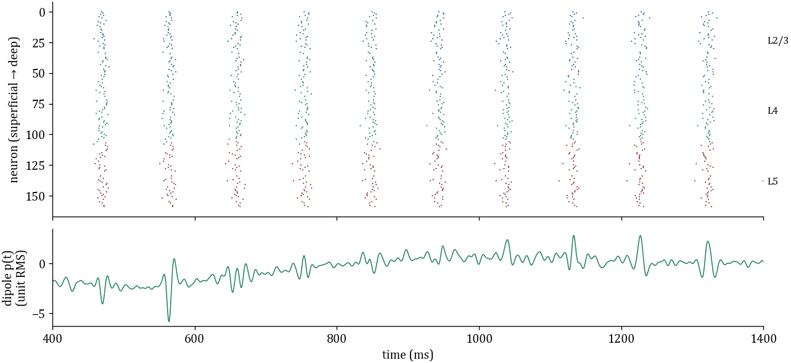
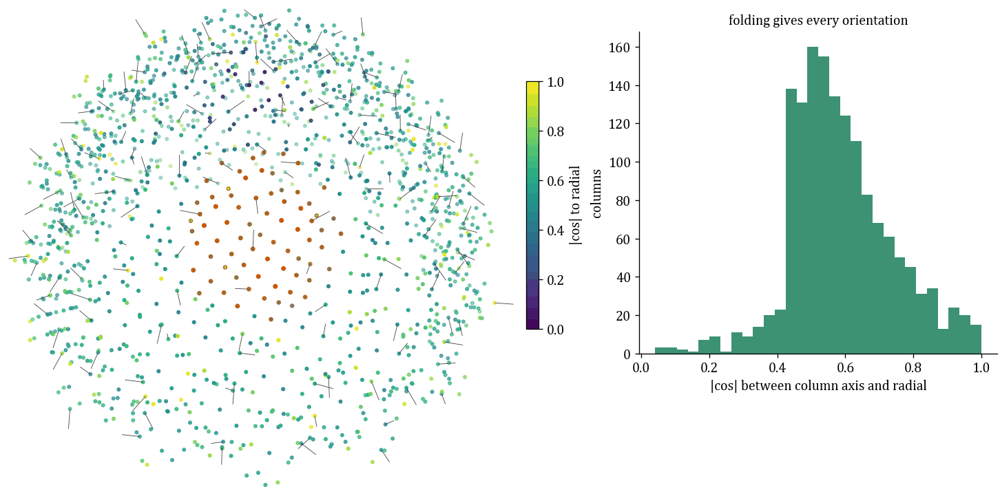
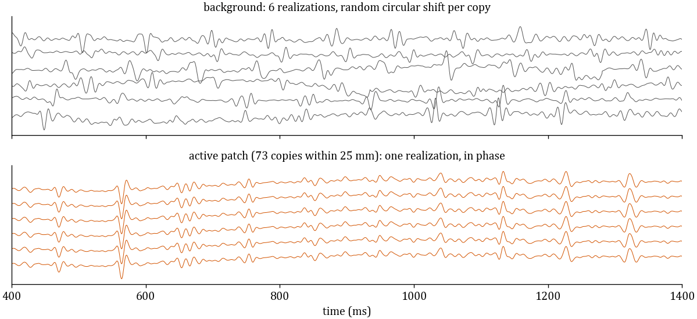
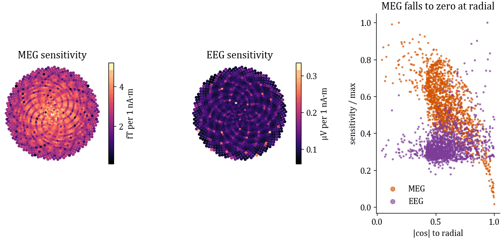
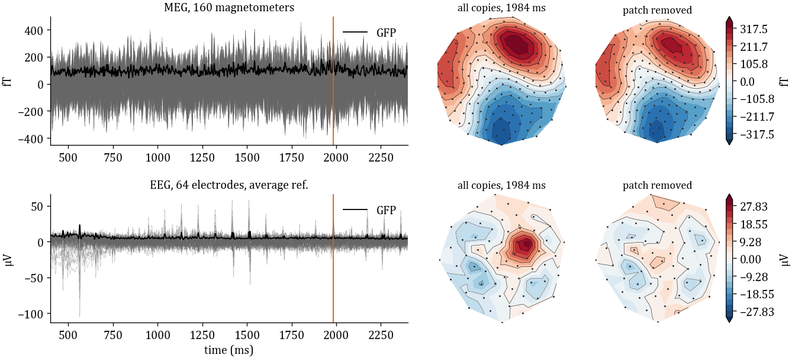
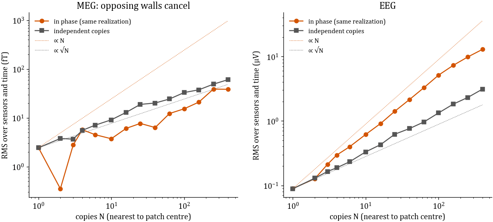
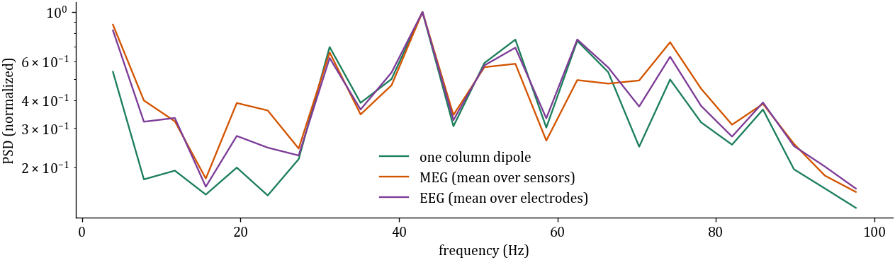

# MEG and EEG from one column

One simulated laminar column is copied across a folded cortex and forwarded to MEG and EEG sensors
with `jaxfne.fields.head`. The functions and their arguments are listed in
[From one column to MEG and EEG](../../reference/api/readout/fields.md#from-one-column-to-meg-and-eeg).
Every figure on this page is produced by

```bash
python scripts/generate_meg_eeg_figures.py
```

which writes the PNGs to `docs/assets/meg_eeg/` and prints the numbers quoted below.

## 1. One column

The column holds 160 Izhikevich neurons (E 0.8, PV 0.2) in three layers, L2/3, L4 and L5, simulated
for 2400 ms at dt = 0.5 ms with six seeds (100–105; 3326–3332 spikes per seed). `column_dipole`
reduces its sources to the axial dipole $p(t) = \sum_i Q_i(t)\,(z_i - \bar z)$, which is filtered
to 1–100 Hz after a 400 ms burn-in and scaled to unit RMS.



*Spikes by depth (superficial at top) and the column's dipole for seed 100.*

## 2. The cortex

`folded_sphere_surface(1500)` places 1500 copies 59.0–77.0 mm from the centre. Each copy points
along the local outward normal, from deep to superficial layers, so the folding sets its angle to
the radial direction.



*Columns coloured by |cos| between the column axis and the radial direction; the in-phase patch is
orange.*

## 3. The activity

`tile_column_dipoles` gives each copy one of the six realizations with a random circular time shift.
The 73 copies within 25 mm of one point form a patch that shares realization 0 with zero shift.
Each copy carries a declared 1 nA·m RMS dipole.



*Six background copies (top) and six patch copies (bottom).*

## 4. Sensitivity

MEG uses `meg_sphere_leadfield` (Sarvas 1987) with 160 radial magnetometers at 0.12 m. EEG uses
`eeg_sphere_leadfield` (Frank 1952) with 64 electrodes on a 0.09 m sphere, σ = 0.33 S/m, average
reference. Per 1 nA·m column, the RMS over sensors is 0.089–5.20 fT for MEG (median 2.90) and
0.060–0.335 µV for EEG (median 0.106). MEG sensitivity falls toward zero for radial columns; EEG
sensitivity stays.



*Per-column sensitivity on the flattened cortex, and against |cos| to radial.*

## 5. The sensors

The sum of all 1500 copies gives a median global field power of 96.3 fT for MEG and 5.11 µV for
EEG, with peaks of 455 fT and 104.8 µV. At 1984 ms the patch's own field carries 81% of the EEG
map's RMS and 11% of the MEG map's RMS.



*Sensor traces with GFP (left) and topographies at 1984 ms with all copies and with the patch
removed (right).*

## 6. How copies add up

The copies nearest the patch centre are summed for N = 1 to 400, either in phase or as independent
draws. From 1 to 400 copies, EEG grows 143.9× in phase and 35.1× independent, close to N = 400 and
√N = 20. MEG grows 15.7× in phase and 25.0× independent: in-phase copies on opposing sulcal walls
cancel.



*RMS over sensors and time; dotted lines are ∝ N and ∝ √N from N = 1.*

## 7. Spectra



*Welch spectra, each normalized to its maximum between 2 and 100 Hz. The sensors keep the column's
peaks above 30 Hz and carry more power below 30 Hz.*

## Assumptions

- The head is one homogeneous sphere; skull and scalp layers are not modelled, so EEG is larger and
  more local than in a layered head.
- The cortex is a synthetic folded sphere; it is no individual anatomy.
- The column's sources are in relative units; the 1 nA·m RMS per column is a declared scale.
