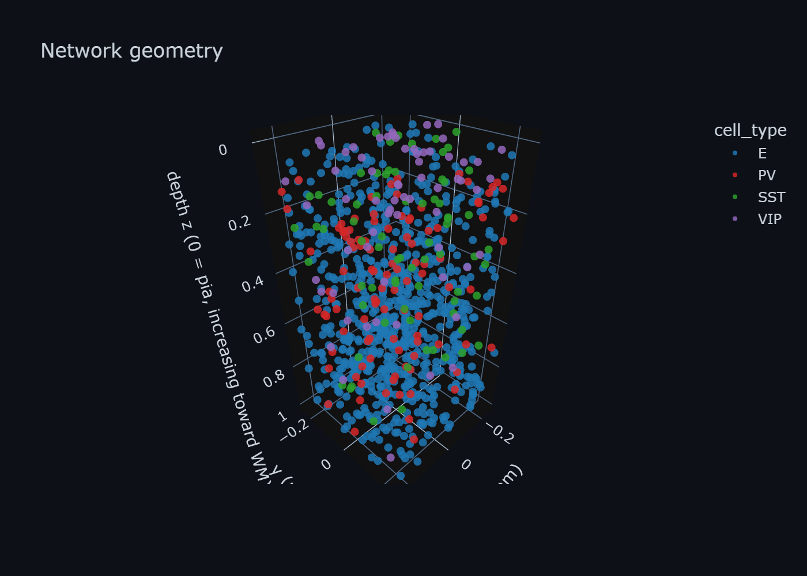

# jaxfne

JaxFNE is a Python package for biophysical source-field modeling. It couples
neural activity and biophysical state with plasticity, geometry, and population-
and field-scale dynamics, and each of these can be changed within one model.

**Workflow:** change biology → change dynamics → simulate → measure

A model is declared once and executed by one compiler:

<div class="mermaid">
flowchart LR
  C["CircuitSpec<br/>Configuration or NeuronalTensor"] -->|construct| M["Model"] -->|simulate| S["Signals"]
</div>

and its science reads from emitters to a manifest:

<div class="mermaid">
flowchart LR
  E["Emitter<br/>neural dynamics"] --> Q["Source<br/>currents Q"] --> F["Field<br/>Φ(r, t)"] --> P["Probe<br/>LFP, CSD, EEG"]
  P --> O["Objective"] --> Op["Optimizer"] --> Mf["Manifest"]
</div>

- **State**: add or change biophysical state $H$.
- **Mechanism**: change dynamics, plasticity, connectivity, geometry, or model detail.
- **Observation**: measure spikes, population activity, or fields.
- **Reduction**: develop or reduce models with [JDNA](guides/grammar/jdna.md).

[Scope & status](reference/project/scope_and_status.md) · [Quickstart](start/quickstart.md)

## Install

```bash
pip install -U jaxfne
pip install "jaxfne[viz]"
```

## Minimal example

```python
import jaxfne as jtfne

jtfne.enable_x64()
tensor  = jtfne.load_canonical_neuronal_tensor("canonical-v1-column-1000n")
model   = jtfne.construct(tensor, jtfne.RuntimeConfiguration(seed=0, duration_ms=1000.0, dt_ms=0.5))
signals = jtfne.simulate(model)
```

> Canonical example uses a qualitative laminar scaffold — see [Scope & status](reference/project/scope_and_status.md#biological-calibration-status-canonical-v1-column).

## Main pages

- [Quickstart](start/quickstart.md) — build paths, paradigms, H-state adaptation
- [Tutorials](tutorials/index.md) — worked examples
- [Canonical Atlas Suite](guides/interop/atlas_suite.md) — 7-panel interactive atlas
- [Études](etudes/index.md) — demonstrated scientific propositions
- [API reference](reference/api/index.md)
- [H-state / HDP guide](guides/state/hdp.md)

## Canonical Visualization Atlas

Seven linked panels (`schema`, `network_3d`, `raster`, `lfp`, `h_dynamics`, `hdp`, `oscillatory`) label each quantity **OBSERVED** or **DERIVED** and carry
manifest provenance. A panel whose declared inputs are missing renders an omission card. Representative preview from realized `canonical-v1-column-1000n` output:

<a href="guides/interop/atlas_suite/">
  
</a>

Full panel set, generation workflow, and provenance rules:
[Canonical Atlas Suite guide](guides/interop/atlas_suite.md).

Canonical 1000-neuron column, pinned 1000 ms reference run:

*Canonical V1 Column (1000n): spike raster.*

([Circuit schematic](https://hnxj.github.io/jaxfne/figures/readme/schema.html) · [Network 3D](https://hnxj.github.io/jaxfne/figures/readme/network_3d.html) · [Spike raster](https://hnxj.github.io/jaxfne/figures/readme/raster.html) · [LFP proxy](https://hnxj.github.io/jaxfne/figures/readme/lfp.html) · [Oscillatory response](https://hnxj.github.io/jaxfne/figures/readme/oscillatory.html)).

Twenty-area hierarchy (Atlas AT-10-N20), areas in hierarchy order with
inter-area edge counts ([full page](https://hnxj.github.io/jaxfne/figures/area_graph_n20/area_graph_n20.html)):

=== "Still"

    

=== "Interactive"

    <iframe class="jx-frame" src="https://hnxj.github.io/jaxfne/figures/area_graph_n20/area_graph_n20.html" loading="lazy" title="Twenty-area hierarchy graph"></iframe>

Three-area hierarchy (`V1–V4–PFC`, 100 neurons/area, bidirectional
feedforward/feedback): [Gallery 09](start/gallery.md#09-three-area-hierarchy-v1v4pfc)
with the full six-panel atlas:


*V1-V4-PFC three-area hierarchy (100/area): spike raster.*

([Circuit schematic](https://hnxj.github.io/jaxfne/figures/three_area/schema.html) · [Network 3D](https://hnxj.github.io/jaxfne/figures/three_area/network_3d.html) · [Spike raster](https://hnxj.github.io/jaxfne/figures/three_area/raster.html) · [LFP proxy](https://hnxj.github.io/jaxfne/figures/three_area/lfp.html) · [Oscillatory response](https://hnxj.github.io/jaxfne/figures/three_area/oscillatory.html)).
